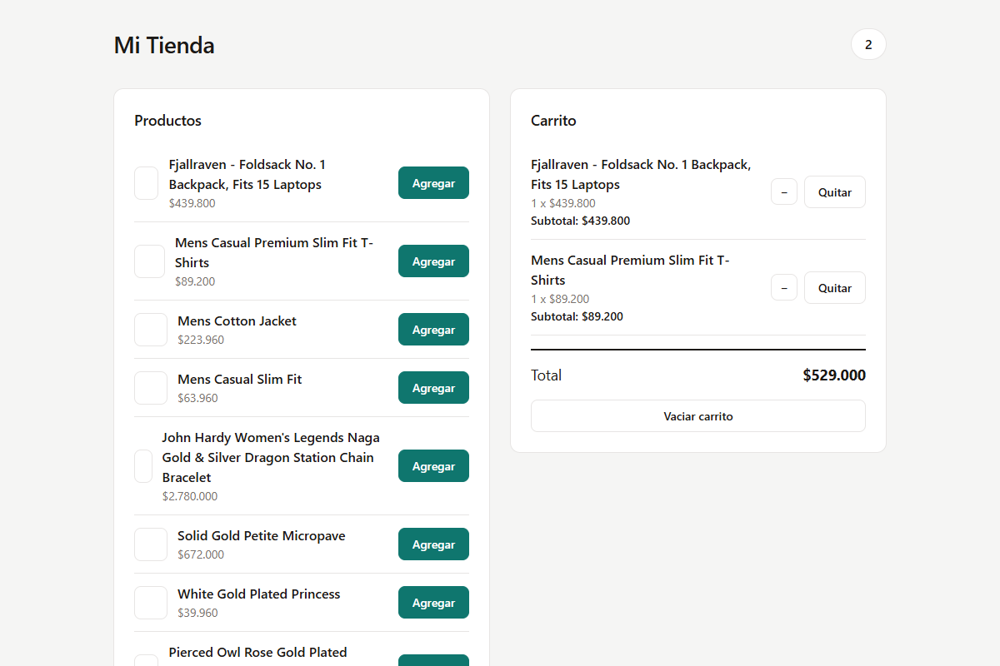

# Mi Tienda — Carrito de compras con React y Zustand

Práctica del programa **Análisis y Desarrollo de Software (SENA)**.
Guía: _Carrito de compras con React y Zustand_ — Instructor Juan Pablo Chamizzo Vega.

Tienda en React con un carrito de compras cuyo estado se comparte entre
componentes usando **Zustand**, sin pasar props ni usar Providers. Incluye los
pasos 1 a 10 de la guía y los cuatro retos de extensión.



## Resultado de aprendizaje

Implementar un estado global en una aplicación React con la librería Zustand,
separando datos, lógica y vista.

## Requisitos

- Node.js 18 o superior
- npm
- Conexión a internet (el catálogo se carga desde una API)
- Conocer componentes, props, `useState` y el método `map` de los arreglos

## Cómo ejecutarlo

```bash
# Entrar a la carpeta del proyecto
cd carrito-zustand

# Instalar dependencias
npm install

# Iniciar el servidor de desarrollo
npm run dev
```

Abre en el navegador `http://localhost:5173`.

Otros comandos:

```bash
npm run build     # Compila la versión de producción
npm run lint      # Revisa el estilo del código
npm run captura   # Comprueba el checklist y regenera docs/captura-tienda.png
```

> `npm run captura` solo es una ayuda de evidencia: necesita `npm run dev`
> corriendo y usa Puppeteer con el Edge/Chrome del sistema.

## Estructura del proyecto

```
src/
├── store/
│   └── useCarritoStore.js    ← estado global (Zustand)
├── components/
│   ├── Encabezado.jsx        ← título y contador
│   ├── ListaProductos.jsx    ← catálogo (desde la API)
│   └── Carrito.jsx           ← carrito y total
├── App.jsx                   ← une los componentes
├── index.css                 ← estilos de la app
└── main.jsx                  ← punto de entrada
```

Cada carpeta tiene una responsabilidad: `store` la lógica del estado y
`components` la parte visual. Los datos de la tienda ya no viven en un archivo
local, sino que llegan desde la API (reto 4).

## Cómo funciona el store

El store vive en `src/store/useCarritoStore.js` y se crea con
`create(persist((set) => ({ ... })))`. Contiene:

| Elemento | Tipo | Qué hace |
| --- | --- | --- |
| `items` | estado | Arreglo con los productos del carrito |
| `agregarProducto` | acción | Agrega un producto o suma 1 a su cantidad |
| `disminuirCantidad` | acción | Resta 1; si llega a 0, saca el producto del carrito |
| `eliminarProducto` | acción | Quita un producto por su `id` |
| `vaciarCarrito` | acción | Deja el carrito vacío |

Ningún componente guarda su propia copia del carrito: todos leen el mismo
store, por eso el `Encabezado` se actualiza aunque no reciba props.

## Retos de extensión

1. **Disminuir cantidad.** Acción `disminuirCantidad` en el store y botón `−` en
   cada fila del carrito. Si la cantidad llega a 0, el producto sale del carrito.
2. **Subtotal por producto.** Cada fila del carrito muestra
   `precio x cantidad` en la línea `Subtotal`.
3. **Carrito persistente.** El store usa el middleware `persist` de Zustand
   (`import { persist } from 'zustand/middleware'`), de modo que el carrito se
   guarda en `localStorage` (clave `carrito-zustand`) y no se pierde al recargar.
4. **Productos desde una API.** `ListaProductos` hace `fetch` a
   `https://fakestoreapi.com/products` y adapta las propiedades
   (`title → nombre`, `price → precio`, `image → imagen`). Los precios llegan en
   dólares y se convierten a pesos con una tasa aproximada. Si la petición falla
   o tarda más de 8 segundos, se muestra un mensaje de error con botón
   **Reintentar**.

## Checklist de comprobación (paso 10)

Verificado automáticamente con `npm run captura` (16/16 correctas):

- [x] Al cargar la página, el carrito dice "Tu carrito está vacío" y la insignia muestra 0.
- [x] Al agregar un producto, aparece en el carrito y la insignia sube a 1.
- [x] Al agregar otra vez el mismo producto, no se duplica la fila: la cantidad pasa a 2.
- [x] El total se recalcula con cada producto agregado.
- [x] El botón Quitar elimina solo ese producto.
- [x] El botón Vaciar carrito deja la insignia en 0 y muestra el mensaje de vacío.
- [x] En una pantalla angosta, los dos paneles se ubican uno debajo del otro.
- [x] Cada fila muestra su subtotal (reto 2).
- [x] El botón `−` reduce la cantidad y elimina al llegar a 0 (reto 1).
- [x] El carrito se conserva al recargar la página (reto 3).
- [x] El catálogo se carga desde la API (reto 4).

## Preguntas de reflexión

**1. ¿Por qué `Encabezado` se actualiza cuando agregas un producto, si no recibe
ninguna prop?**

Porque no depende de las props sino del store. `Encabezado` se suscribe a
`items` con `useCarritoStore((state) => state.items)`. Zustand avisa a todos los
componentes suscritos cuando esa parte del estado cambia y React los vuelve a
dibujar. La comunicación ocurre a través del store global, no del árbol de
componentes, por eso `Encabezado` y `Carrito` no necesitan ser parientes ni
compartir props.

**2. ¿Qué tendrías que hacer para lograr lo mismo usando solo `useState` en
`App`?**

Tendría que subir el estado a `App` con `useState` (`const [items, setItems] =
useState([])`) y crear allí las funciones para agregar, quitar y vaciar. Luego
pasarle `items` y esas funciones hacia abajo como props: `Encabezado` recibiría
`items`, `ListaProductos` recibiría `agregarProducto` y `Carrito` recibiría
`items`, `eliminarProducto` y `vaciarCarrito`. Eso se conoce como _prop
drilling_: cada componente intermedio tiene que transportar datos que no usa.
Con Zustand cada componente se conecta directo al store y `App` solo organiza la
página.

**3. ¿Para qué sirve el selector `(state) => state.items` al usar el hook?**

Sirve para elegir qué parte del estado necesita el componente. Al pasarle un
selector, el componente solo se vuelve a dibujar cuando cambia el valor
seleccionado y no cada vez que cambia cualquier propiedad del store. Por
ejemplo, `ListaProductos` solo pide `agregarProducto`, entonces no se redibuja
cuando cambian los `items`. Es una forma de optimizar el rendimiento y de dejar
claro de qué dato depende cada componente.

**4. ¿Por qué en el store se crean arreglos nuevos con `map` y `filter` en lugar
de modificar `items` directamente?**

Porque en React el estado debe ser inmutable. Si se modificara el arreglo con
`push` o asignaciones directas, la referencia seguiría siendo la misma y React
(o Zustand) no detectaría el cambio, por lo que la pantalla no se actualizaría.
Al crear un arreglo nuevo con `map`, `filter` o el operador spread (`...`),
cambia la referencia y la actualización se propaga. Además evita efectos
secundarios: los datos anteriores quedan intactos y es más fácil razonar el
estado.

**5. ¿Zustand es parte de React? Explica la diferencia entre una librería propia
de React y una del ecosistema.**

No, Zustand no es parte de React. Es una librería externa y ligera que se
instala aparte (`npm install zustand`). Una librería _propia_ de React es la que
mantiene el equipo de React y viene incluida o se instala desde su mismo
repositorio oficial (`react`, `react-dom`). Una librería del _ecosistema_ es
una solución creada por la comunidad o por terceros que se apoya en las APIs de
React para resolver un problema concreto: Zustand es un ejemplo (estado global),
como también lo son React Router, Redux o React Query. React funciona sin ellas;
solo agregan capacidades.

## Entregable

- [x] Proyecto React + Vite con Zustand
- [x] README con la captura de la tienda funcionando
- [x] Respuestas a las preguntas de reflexión
- [x] Los cuatro retos de extensión
- [ ] Subir el proyecto a un repositorio de GitHub

> Para publicarlo: crea un repositorio vacío en GitHub y luego ejecuta
> `git remote add origin <URL>` y `git push -u origin main`.
